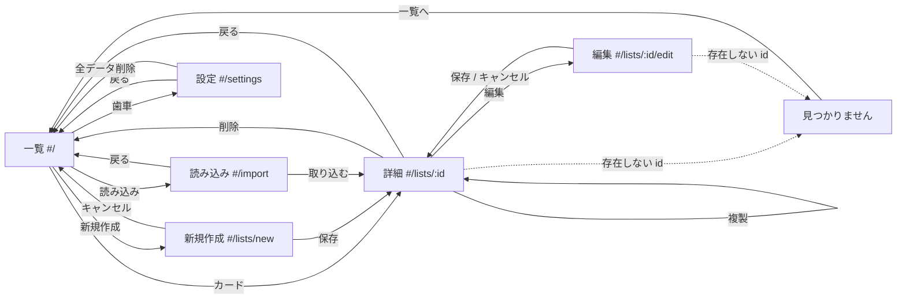

# 画面設計書

- 作成日: 2026-10-22
- ステータス: 確定（2026-10-23 レビュー完了）
- 関連文書: [要件定義書](../requirements.md)、[仕様書](../spec.md)（5 章、7 章、8 章）、[データ設計書](./data.md)

本書は仕様書 5 章（画面仕様）、7 章（PWA）、8 章（テーマ）を、実装者がそのまま画面とコンポーネントに落とせる粒度まで確定する。仕様書と食い違う記述があれば仕様書を直してから本書を直す。

## 1. 画面遷移図



ダイアログ（画面遷移を伴わない）:

| ダイアログ | 起点 | 確定時 |
| --- | --- | --- |
| リセット確認 | 詳細の「…」→ リセット | 全チェック解除。同じ画面に留まる |
| 削除確認 | 詳細の「…」→ 削除 | 削除して一覧へ |
| 破棄確認 | 編集・新規作成の「キャンセル」「戻る」（変更があるとき） | 変更を捨てて遷移 |
| 全データ削除確認（2 段階） | 設定の「全データを削除」 | DB と設定を初期化して一覧へ |
| 更新通知（トースト） | 新しい Service Worker の検出 | 「再読み込み」でページを更新 |

ブラウザの「戻る」は hash 形式の履歴に従う。編集中に「戻る」を押したときも破棄確認を出す。これには react-router の `useBlocker` を使うが、このフックはデータルーター専用で `<HashRouter>` 配下では実行時エラーになるため、ルーターは `createHashRouter` + `RouterProvider` で構成する（仕様書 2 章・5 章）。ルート定義は `src/app/router.tsx` に 1 箇所で持つ。

## 2. 共通レイアウト

### 2.1 画面構成

```
┌──────────────────────────────┐
│ ヘッダー（高さ 56px、上部固定）   │  アプリ名（#/ へのリンク） … 右端に歯車（#/settings）
├──────────────────────────────┤
│ メイン（左右 16px 余白）         │  幅 640px 未満: 1 カラム全幅
│                              │  幅 640px 以上: 最大幅 720px で中央寄せ
│                              │
├──────────────────────────────┤
│ トースト領域（下部固定、重ねる）   │  更新通知、保存失敗など
└──────────────────────────────┘
```

- ヘッダーのアプリ名は「チェックリスト」。詳細・編集・読み込み・設定では、アプリ名の左に「← 戻る」を置く（遷移先は 1 章の「戻る」）。
- タップ領域は最小 44 × 44px。行全体がタップ可能なものは、行の高さも 44px 以上にする。
- ローディングは画面単位で、メインの中央にスピナーと「読み込み中」を出す。IndexedDB の読み取りは数十 ms で終わるため、200ms 以内に終わった場合はスピナーを出さない（ちらつき防止）。

### 2.2 テーマと色

CSS 変数で定義し、Tailwind の `darkMode: 'class'` で切り替える。

| 変数 | 用途 | ライト | ダーク |
| --- | --- | --- | --- |
| `--bg` | 画面背景 | `#ffffff` | `#111418` |
| `--bg-card` | カード、入力欄の背景 | `#f6f7f9` | `#1b2027` |
| `--fg` | 本文 | `#1a1d21` | `#e6e8eb` |
| `--fg-muted` | 補助文字（日時、プレースホルダ） | `#5c6670` | `#9aa4ae` |
| `--border` | 罫線 | `#d9dde2` | `#2c333c` |
| `--accent` | 主ボタン、チェック済み、進捗バー | `#2563eb` | `#60a5fa` |
| `--danger` | 削除、期限超過 | `#dc2626` | `#f87171` |
| `--warning` | 今日が期限 | `#d97706` | `#fbbf24` |
| `--success` | すべて完了 | `#16a34a` | `#4ade80` |

- 本文と背景のコントラスト比は両テーマで 4.5:1 以上。`--fg-muted` も 4.5:1 以上を満たす値を選ぶ。
- 実装時に上記の値でコントラストを計測し、満たさなければ値を調整して本表を更新する。

### 2.3 文字サイズ

| 用途 | サイズ |
| --- | --- |
| 画面タイトル（リスト名） | 20px / 太字 |
| 本文、項目名、入力欄 | 16px（iOS のフォーカス時ズームを避けるため 16px 未満にしない） |
| 補助（タグ、日時、メモ） | 14px |

## 3. 画面ごとの設計

ワイヤーフレームは左が幅 360px、右が幅 720px。720px では中央寄せになるだけで要素は同じ。

### 3.1 一覧（`#/`）

```
360px                                   720px（最大幅 720、中央寄せ）
┌────────────────────────────┐          ┌──────────────────────────────────────────┐
│ チェックリスト          ⚙  │          │ チェックリスト                        ⚙  │
├────────────────────────────┤          ├──────────────────────────────────────────┤
│ [🔍 リストや項目を検索     ]│          │ [🔍 リストや項目を検索                   ]│
│ (仕事)(家)(リリース)(習慣)  │          │ (仕事)(家)(リリース)(習慣)                 │
│                            │          │                                          │
│ ┌────────────────────────┐ │          │ ┌──────────────────────────────────────┐ │
│ │ リリース手順            │ │          │ │ リリース手順                          │ │
│ │ 仕事 リリース           │ │          │ │ 仕事 リリース                         │ │
│ │ ████████░░░░ 3 / 10    │ │          │ │ ████████████████░░░░░░░░ 3 / 10      │ │
│ │ 更新 10/18 09:30        │ │          │ │ 更新 10/18 09:30                      │ │
│ └────────────────────────┘ │          │ └──────────────────────────────────────┘ │
│ ┌────────────────────────┐ │          │ ┌──────────────────────────────────────┐ │
│ │ 朝のルーティン          │ │          │ │ 朝のルーティン                        │ │
│ │ 習慣                    │ │          │ ...                                      │
│ │ ░░░░░░░░░░░░ 0 / 6     │ │          │                                          │
│ └────────────────────────┘ │          │                                          │
│                            │          │                                          │
│        [ 読み込み ] [＋ 新規作成 ]     │  （ボタンは右下に固定、720px でも同じ）    │
└────────────────────────────┘          └──────────────────────────────────────────┘
```

**要素**

| 要素 | 内容 |
| --- | --- |
| 検索ボックス | `type="search"`、プレースホルダ「リストや項目を検索」。入力を 150ms デバウンスして `searchChecklists` を呼ぶ。クリアボタン（×）あり |
| タグチップ列 | 存在するタグを五十音・アルファベット順に横並び（折り返しあり）。選択で反転表示。複数選択は AND。タグが 0 個なら列ごと非表示 |
| カード | タイトル（1 行、溢れは `…`）、タグ（最大 3 個表示、4 個以上は `+N`）、進捗バーと `完了数 / 総数`、「更新 M/D HH:mm」。カード全体がリンク。全件完了は進捗バーを `--success` にし「すべて完了」を添える |
| 主操作 | 右下に固定の「＋ 新規作成」（主ボタン）と「読み込み」（副ボタン）。スクロールしても見える |

**状態**

| 状態 | 表示 |
| --- | --- |
| ローディング | 2.1 節の規則 |
| 空（リスト 0 件） | 検索・タグ列を出さず、中央に「まだチェックリストがありません」と「＋ 新規作成」「ファイルを読み込む」の 2 ボタン |
| 検索結果 0 件 | 「「<検索語>」に一致するリストはありません」。タグ絞り込みのみ 0 件なら「選択したタグを持つリストはありません」 |
| 読み取り失敗 | 「リストを読み込めませんでした」と「再試行」 |

### 3.2 詳細（`#/lists/:id`）

```
360px
┌────────────────────────────┐
│ ← リリース手順          ⋯  │   ← 戻るは一覧へ。⋯ は操作メニュー
├────────────────────────────┤
│ 本番リリース前に必ず通す確認  │   説明（空なら非表示）
│ 仕事 リリース               │   タグ（空なら非表示）
│ ████████░░░░ 3 / 10  [編集] │   進捗バー、全件完了なら「すべて完了」
├────────────────────────────┤
│ ☑ ~~CI が緑であることを確認~~│
│   完了 10/18 09:30  🔗      │   完了日時、リンクアイコン
│ ☐ リリースノートを書く      │
│   前回との差分を箇条書き     │   補足メモ（空なら非表示）
│   期限 10/20                │   期限（通常）
│ ☐ タグを打つ                │
│   ⚠ 期限超過 10/17          │   期限超過（--danger）
│ ☐ 告知を出す                │
│   ● 今日 10/22              │   今日（--warning）
│ ...                         │
└────────────────────────────┘

操作メニュー（⋯ を押すとボトムシート。720px ではドロップダウン）
┌────────────────────────────┐
│ ↺ リセット                  │
│ ⧉ 複製                      │
│ ⤓ 書き出し                  │
│ 🗑 削除（--danger）          │
│ キャンセル                   │
└────────────────────────────┘
```

**要素**

| 要素 | 内容 |
| --- | --- |
| 項目行 | 行全体がチェック切り替えのタップ領域（`<label>` でチェックボックスを包む）。リンクアイコンだけは別のタップ領域（`<a target="_blank" rel="noopener noreferrer">`）で、押してもチェックは切り替わらない |
| チェック済み | タイトルに取り消し線、`--fg-muted`。「完了 M/D HH:mm」を 2 行目に表示 |
| 期限 | データ設計書 2 章の 3 状態。`overdue` は「⚠ 期限超過 M/D」を `--danger`、`today` は「● 今日 M/D」を `--warning`、`normal` は「期限 M/D」を `--fg-muted`。チェック済みは期限を表示しない |
| 進捗 | `完了数 / 総数`。項目 0 件のときは `0 / 0` と「項目がありません。編集から追加してください」 |
| 「編集」 | `#/lists/:id/edit` へ |

**状態**

| 状態 | 表示 |
| --- | --- |
| 存在しない `id` | 3.6 節の「見つかりません」 |
| 書き込み失敗（チェック） | 楽観更新を巻き戻し、トースト「保存できませんでした」 |

### 3.3 編集（`#/lists/:id/edit`）と新規作成（`#/lists/new`）

```
360px
┌────────────────────────────┐
│ ← リストを編集       [保存] │   新規作成では「新しいリスト」。保存は主ボタン
├────────────────────────────┤
│ タイトル *                  │
│ [リリース手順              ]│
│ 説明                        │
│ [本番リリース前に…         ]│   複数行、自動で高さ拡張
│ タグ                        │
│ (仕事 ×)(リリース ×)[追加…]│   Enter またはカンマで確定
├────────────────────────────┤
│ 項目                        │
│ ≡ [CI が緑であることを確認] 🗑│   ≡ ドラッグハンドル
│    ▸ 詳細                   │   押すとメモ・URL・期限が開く
│ ≡ [リリースノートを書く   ] 🗑│
│    ▾ 詳細                   │
│      補足メモ               │
│      [前回との差分を箇条書き]│
│      URL                    │
│      [https://…           ]│
│      期限                   │
│      [2026-10-20]  [クリア] │
│ ≡ [                      ] 🗑│   空行（追加直後）
│ [＋ 項目を追加]             │
│                            │
│ [キャンセル]                │
└────────────────────────────┘
```

**要素**

| 要素 | 内容 |
| --- | --- |
| タイトル | `required`、`maxLength` は付けない（コードポイントで数えるため）。残り文字数は表示しない。超過時に直下へエラー |
| 説明 | `textarea`、自動で高さ拡張（最小 2 行、最大 10 行でスクロール） |
| タグ入力 | チップ列の末尾に入力欄。Enter または `,` で確定。Backspace で入力が空なら直前のチップを削除。確定時に `trim` と重複除去。21 個目は確定せずエラー |
| 項目行 | ドラッグハンドル（≡）、タイトル入力、削除ボタン（🗑）。タイトル入力で Enter を押すと直下に空行を追加しフォーカスを移す。空行のまま保存しようとしたらエラー（空行は自動では捨てない。誤って消えたと思わせないため） |
| 「詳細」 | 行ごとの開閉。メモ・URL・期限のどれかに値があれば初期状態で開く |
| 期限 | `<input type="date">`。「クリア」で `null` |
| 「＋ 項目を追加」 | 末尾に空行を追加しフォーカスを移す |
| 「保存」 | ヘッダー右。検証エラーがあれば最初のエラー欄へスクロールしフォーカス。成功で詳細へ |
| 「キャンセル」 | 変更があれば破棄確認。なければそのまま詳細（新規作成では一覧）へ |

**ドラッグ並び替え**（@dnd-kit/sortable）

- マウス: ハンドルを押してドラッグ。
- タッチ: ハンドルを 150ms 長押ししてからドラッグ（スクロールと区別するため）。
- キーボード: ハンドルにフォーカス → Space で持ち上げ → ↑↓ で移動 → Space で確定、Esc で取り消し。
- ドラッグ中は行を半透明にし、挿入位置に 2px の `--accent` 線を出す。

**状態**: 7.1 節の状態遷移に従う。

### 3.4 読み込み（`#/import`）

```
360px（ファイル選択前）                 360px（検証成功、プレビュー）
┌────────────────────────────┐          ┌────────────────────────────┐
│ ← ファイルを読み込む        │          │ ← ファイルを読み込む        │
├────────────────────────────┤          ├────────────────────────────┤
│ ┌ ─ ─ ─ ─ ─ ─ ─ ─ ─ ─ ─ ┐ │          │ release-20261018.json      │
│   ⤒                        │          │ ┌────────────────────────┐ │
│   ここにファイルをドロップ    │          │ │ リリース手順            │ │
│   または                    │          │ │ 仕事 リリース           │ │
│   [ファイルを選択]           │          │ │ 本番リリース前に…       │ │
│ └ ─ ─ ─ ─ ─ ─ ─ ─ ─ ─ ─ ┘ │          │ │ 項目 10 件              │ │
│                            │          │ │  1. CI が緑であることを… │ │
│ このアプリで書き出した       │          │ │  2. リリースノートを書く │ │
│ .json ファイルを読み込めます │          │ │  ...                   │ │
│                            │          │ └────────────────────────┘ │
│                            │          │ チェック状態はすべて未完了   │
│                            │          │ で取り込まれます            │
│                            │          │ [別のファイル] [取り込む]   │
└────────────────────────────┘          └────────────────────────────┘
```

**要素と状態**

| 状態 | 表示 |
| --- | --- |
| 初期 | ドロップ領域（点線枠）と「ファイルを選択」（`<input type="file" accept=".json,application/json">`）。スマートフォンではドロップ領域の文言を「ファイルを選択してください」にする |
| ドラッグオーバー | 枠を `--accent` の実線にし背景を薄く着色 |
| 検証中 | ドロップ領域の中にスピナー。20 MB（20,000,000 バイト。データ設計書 5.3 節）を超えるファイルは読まずにエラー |
| エラー | ドロップ領域の下に `--danger` の枠で文言（6 章）を出す。`VALIDATION` は違反箇所を「項目 3 の URL: http または https の URL を入力してください」の形で最大 10 件列挙。領域は残り、別のファイルを選び直せる |
| プレビュー | ファイル名、タイトル、タグ、説明（先頭 3 行）、項目数、項目タイトルを最大 20 件（以降は「ほか N 件」）。「取り込む」で `importChecklist` → 詳細へ。「別のファイル」で初期状態へ |

### 3.5 設定（`#/settings`）

```
360px
┌────────────────────────────┐
│ ← 設定                      │
├────────────────────────────┤
│ テーマ                      │
│ (●) OS に合わせる           │
│ ( ) ライト                  │
│ ( ) ダーク                  │
├────────────────────────────┤
│ データ                      │
│ データはこのブラウザの中にだけ │
│ 保存されています。大切なリスト │
│ は書き出して保管してください。 │
│ [全データを削除]（--danger） │
├────────────────────────────┤
│ アプリ情報                   │
│ バージョン 0.1.0            │
│ GitHub リポジトリ ↗         │
└────────────────────────────┘
```

- テーマはラジオボタン。選択した瞬間に反映し `localStorage` に保存する。
- 「全データを削除」→ ダイアログ 1「すべてのチェックリストと設定を削除します。この操作は取り消せません」[キャンセル][次へ] → ダイアログ 2「確認のため「削除」と入力してください」[入力欄] [キャンセル][削除（入力が一致するまで無効）] → `clearAllData` → 一覧（空状態）へ。
- バージョンはビルド時に `package.json` から埋め込む。

### 3.6 見つかりません・DB エラー

| 画面 | 表示 |
| --- | --- |
| 見つかりません | 「リストが見つかりません」「削除されたか、別のブラウザで作成されたリストかもしれません」[一覧へ] |
| DB を開けない | ヘッダーのみ残し、メインに「データを保存できない環境です」と原因別の説明（データ設計書 3.4 節）。操作ボタンはなし |

## 4. コンポーネント一覧

`src/components/` に置く再利用部品。画面固有のものは `src/pages/<画面>/` の中に置き、ここには載せない。

| コンポーネント | 役割 | props | イベント |
| --- | --- | --- | --- |
| `AppShell` | ヘッダー、メイン、トースト領域 | `title`, `backTo?: string`, `actions?: ReactNode` | なし |
| `Button` | 主・副・危険の 3 種 | `variant: "primary" \| "secondary" \| "danger"`, `disabled?`, `type?` | `onClick` |
| `IconButton` | アイコンのみ（44px） | `label`（`aria-label`）, `icon` | `onClick` |
| `TextField` | ラベル付き 1 行入力 | `label`, `value`, `error?`, `required?`, `placeholder?`, `inputMode?` | `onChange`, `onKeyDown` |
| `TextArea` | ラベル付き複数行、自動拡張 | `label`, `value`, `error?`, `minRows`, `maxRows` | `onChange` |
| `TagInput` | チップ列＋入力 | `tags: string[]`, `error?` | `onChange(tags)` |
| `TagChip` | タグ表示。選択可・削除可 | `label`, `selected?`, `removable?` | `onClick?`, `onRemove?` |
| `ProgressBar` | 進捗バーと `n / m` | `done`, `total`, `complete?`（`--success` 表示） | なし |
| `ChecklistCard` | 一覧のカード | `checklist: Checklist` | なし（内部で `Link`） |
| `ChecklistItemRow` | 詳細の項目行 | `item: ChecklistItem`, `dueState: "overdue" \| "today" \| "normal"` | `onToggle(checked)` |
| `ItemEditorRow` | 編集の項目行（ハンドル、入力、詳細開閉） | `item: ChecklistItemInput`, `errors?`, `expanded` | `onChange(item)`, `onRemove()`, `onEnter()`, `onToggleExpand()` |
| `SortableList` | dnd-kit のラッパ | `ids: string[]`, `renderRow` | `onReorder(from, to)` |
| `ConfirmDialog` | 確認ダイアログ | `open`, `title`, `message`, `confirmLabel`, `danger?`, `confirmInput?: string`（一致するまで確定不可） | `onConfirm`, `onCancel` |
| `ActionMenu` | 「…」メニュー（ボトムシート／ドロップダウン） | `items: {label, icon, danger?, onSelect}[]` | なし |
| `Toast` | 下部通知 | `message`, `actionLabel?`, `duration?` | `onAction?` |
| `EmptyState` | 空状態 | `message`, `actions?: ReactNode` | なし |
| `ErrorState` | 読み取り失敗 | `message` | `onRetry` |
| `DropZone` | ファイルのドロップ領域 | `accept`, `busy?`, `error?` | `onFile(file)` |
| `ThemeProvider` | テーマ適用（`html.dark` の付け外し） | `children` | なし |

状態管理は各画面で `useLiveQuery`（読み取り）とドメイン層 API（書き込み）を直接使う。画面をまたぐ状態はテーマだけで、`ThemeProvider` の Context に置く。

## 5. 操作仕様

### 5.1 キーボードとフォーカス

| 場面 | 操作 |
| --- | --- |
| 詳細の項目 | Tab で行のチェックボックス → リンクアイコンの順にフォーカス。Space でチェック切り替え |
| 編集の項目タイトル | Enter で直下に空行追加＋フォーカス移動。空のタイトル欄で Backspace を押しても行は消えない（削除はボタンのみ） |
| 編集のタグ入力 | Enter / `,` で確定、Backspace で直前チップ削除、Esc で入力内容を消す |
| 並び替え | 3.3 節 |
| ダイアログ | 開いたら最初のボタン（キャンセル）にフォーカス。Esc でキャンセル。フォーカスはダイアログ内に閉じ込め、閉じたら起点の要素に戻す |
| メニュー | 開いたら最初の項目にフォーカス。↑↓ で移動、Enter で選択、Esc で閉じる |
| 画面遷移後 | 画面タイトル（`h1`）にフォーカスを移し、スクリーンリーダーに画面名を読ませる |

### 5.2 確認ダイアログ

| 操作 | タイトル | 本文 | 確定ボタン |
| --- | --- | --- | --- |
| リセット | すべてのチェックを外しますか？ | 完了日時も消えます。項目はそのまま残ります。 | リセット（primary） |
| 削除 | 「<タイトル>」を削除しますか？ | この操作は取り消せません。必要なら先に書き出してください。 | 削除（danger） |
| 破棄 | 変更を破棄しますか？ | 保存していない変更は失われます。 | 破棄（danger） |
| 全データ削除 1 | すべてのデータを削除しますか？ | すべてのチェックリストと設定を削除します。この操作は取り消せません。 | 次へ（danger） |
| 全データ削除 2 | 確認 | 確認のため「削除」と入力してください。 | 削除（danger、入力一致で有効） |

### 5.3 トースト

| 事象 | 文言 | 操作 | 表示時間 |
| --- | --- | --- | --- |
| 新しい Service Worker 検出 | 新しいバージョンがあります | 再読み込み | 消えない |
| 書き込み失敗 | 保存できませんでした。空き容量を確認してください | なし | 5 秒 |
| 複製完了 | 「<タイトル>」を複製しました | なし | 3 秒 |
| 読み込み完了 | 「<タイトル>」を取り込みました | なし | 3 秒 |
| 書き出し完了 | ファイルを書き出しました | なし | 3 秒 |

### 5.4 楽観更新（チェック操作）

項目ごとに「一時状態」と「進行中の書き込み数」を持ち、古い購読更新や失敗が最新の一時状態を上書きしないようにする。

```ts
// 詳細画面のローカル状態（項目 id をキーにする）
optimistic: Map<string, boolean>; // 一時状態。表示はこれを DB の値より優先する
pending: Map<string, number>;     // その項目で完了していない toggleItem の数
```

1. タップ直後に `optimistic[id]` を新しい値にし、`pending[id]` を 1 増やす。表示は `optimistic` にある値を DB の値より優先する。
2. `toggleItem(listId, id, 新しい値)` を呼ぶ。連打は直列化せず都度呼ぶ。DB 側の最終値はデータ設計書 3.2 節のトランザクションで最後の呼び出しの値になる。
3. 呼び出しが完了（成功・失敗を問わず）したら `pending[id]` を 1 減らす。
4. `pending[id]` が 0 になった時点で `optimistic[id]` を削除し、以後は DB の値（`useLiveQuery`）を表示する。`pending[id] > 0` の間は、`useLiveQuery` の更新が届いても `optimistic[id]` を保持し、表示を変えない。
5. 失敗したときは、`pending[id]` が 0 になった時点で表示が DB の値に戻る（巻き戻し）。トースト「保存できませんでした」は失敗ごとに出す。`pending[id] > 0` なら後続の呼び出しが進行中なので、表示は触らない。
6. 進捗バーも `optimistic` を反映した値で計算する。

これにより「未完了 → 完了 → 未完了」と連打して 2 回目の保存中に 1 回目の購読更新が届いても、`pending` が 0 になるまで最新の一時状態（未完了）が表示され続け、最後に DB の最終値に合流する。

## 6. 文言一覧

### 6.1 検証エラー（入力欄の直下）

| code | 対象 | 文言 |
| --- | --- | --- |
| `required` | タイトル | タイトルを入力してください |
| `required` | 項目タイトル | 項目名を入力してください（不要な行は削除してください） |
| `too_long` | タイトル | タイトルは 100 文字以内です |
| `too_long` | 説明 | 説明は 1000 文字以内です |
| `too_long` | タグ | タグは 30 文字以内です |
| `too_many` | タグ | タグは 20 個までです |
| `too_long` | 項目タイトル | 項目名は 200 文字以内です |
| `too_long` | 補足メモ | 補足メモは 2000 文字以内です |
| `invalid_url` | URL | http または https の URL を入力してください |
| `too_long` | URL | URL は 2000 文字以内です |
| `invalid_date` | 期限 | 存在する日付を入力してください |
| `too_many` | 項目 | 項目は 500 件までです |
| `invalid_type` | ファイル形式 | ファイルの形式が正しくありません |
| `required` | 汎用 | 入力してください |
| `too_long` | 汎用 | 文字数が上限を超えています |
| `too_many` | 汎用 | 件数が上限を超えています |
| `invalid_url` | 汎用 | http または https の URL を入力してください |
| `invalid_date` | 汎用 | 存在する日付を入力してください |
| `invalid_type` | 汎用 | 値の形式が正しくありません |
| `unknown_id` | 汎用 | 項目の識別子が不正です。画面を再読み込みしてください |

「汎用」の行は、（`code`, フィールド名）の組み合わせが表にないときの既定文言。`code` と文言の対応はデータ設計書 5.3.1 節の変換規則で引く。

### 6.2 読み込みエラー

| code | 文言 |
| --- | --- |
| `INVALID_JSON` | JSON ファイルとして読めません |
| `NOT_EXPORT_FILE` | このアプリの書き出しファイルではありません |
| `UNSUPPORTED_VERSION` | このファイルは新しいバージョンのアプリで書き出されています。アプリを更新してください |
| `VALIDATION` | ファイルの内容に問題があります（以下に違反箇所を列挙） |

### 6.3 空状態・案内

| 場面 | 文言 |
| --- | --- |
| 一覧が空 | まだチェックリストがありません |
| 検索 0 件 | 「<検索語>」に一致するリストはありません |
| タグ 0 件 | 選択したタグを持つリストはありません |
| 項目 0 件（詳細） | 項目がありません。編集から追加してください |
| すべて完了 | すべて完了 |
| 読み込み案内 | このアプリで書き出した .json ファイルを読み込めます |
| 読み込みプレビュー注記 | チェック状態はすべて未完了で取り込まれます |
| データの注意（設定） | データはこのブラウザの中にだけ保存されています。大切なリストは書き出して保管してください。 |

## 7. 状態遷移

### 7.1 編集画面のローカル状態

```
          開く（既存を読み込み / 新規は空）
               │
               ▼
         ┌──────────┐  入力   ┌──────────┐
         │ 未変更    │ ─────▶ │ 変更あり  │◀─┐
         └──────────┘        └──────────┘  │ 入力
               │                  │         │
   キャンセル / 戻る          保存を押す      │
   → そのまま遷移                 │         │
                                  ▼         │
                          ┌──────────────┐  │
                          │ 検証         │  │
                          └──────────────┘  │
                     エラー │        │ 通過  │
                           ▼        ▼       │
                    ┌──────────┐ ┌────────┐ │
                    │ エラー表示│ │ 保存中  │ │
                    └──────────┘ └────────┘ │
                           │        │  │    │
                       入力で解消   成功  失敗 ─┘（変更ありに戻り、トースト）
                           │        │
                           └──▶ 変更あり   詳細へ遷移
```

- 「変更あり」の判定は、正規化後の `ChecklistInput` を初期値と深い比較して行う。空白だけ付けて戻した場合は「未変更」。
- 「変更あり」で「キャンセル」「戻る」「ブラウザの戻る」「リンク遷移」を行うと破棄確認を出す。
- 「保存中」は保存ボタンを無効にし、二重送信を防ぐ。
- ページを閉じる・再読み込みする操作には `beforeunload` で標準の離脱確認を出す。下書きの自動保存は行わない（仕様書 5.3 節）。

### 7.2 読み込み画面

```
初期 ─ファイル選択/ドロップ─▶ 検証中 ─成功─▶ プレビュー ─取り込む─▶ 保存中 ─成功─▶ 詳細へ
                              │                 │                    │
                             失敗               別のファイル          失敗（トースト、プレビューに戻る）
                              ▼                 ▼
                            エラー ─ファイル選択─▶ 検証中
```

### 7.3 テーマ

```
起動 → localStorage を読む（不正なら system）
     → system なら matchMedia("(prefers-color-scheme: dark)") に追従し、変更イベントも監視
     → light / dark なら固定
設定変更 → 即時に html.dark を更新 → localStorage に保存
```

初回描画でのちらつきを防ぐため、`index.html` の `<head>` にインラインスクリプトを置き、React の起動前に `html.dark` を決める。

### 7.4 Service Worker の更新

```
登録 → 新 SW が waiting になる → トースト「新しいバージョンがあります」[再読み込み]
     → 再読み込み → SW に skipWaiting を送る → controllerchange で location.reload()
```

編集画面で「変更あり」のときはトーストを出すだけで、ユーザーが押すまで何もしない。

## 8. アクセシビリティ

- すべてのアイコンボタンに `aria-label`。アイコンのみの意味伝達をしない（期限超過は色＋「⚠ 期限超過」の文字）。
- チェックボックスは `<input type="checkbox">` を使い、独自描画する場合も `input` を視覚的に隠すだけで DOM に残す。
- ダイアログは `role="dialog"` と `aria-modal="true"`、`aria-labelledby` でタイトルを指す。
- 進捗バーは `role="progressbar"` と `aria-valuenow / aria-valuemax`。
- ドラッグ並び替えはキーボード操作を必ず提供し、操作中の位置を `aria-live="polite"` で読み上げる（dnd-kit の `announcements` を日本語化）。
- フォーカスリングは消さない。`:focus-visible` で 2px の `--accent` を出す。
- 文字サイズを 200% に拡大しても横スクロールが出ないことを確認する。

## 9. 未決事項

なし。
